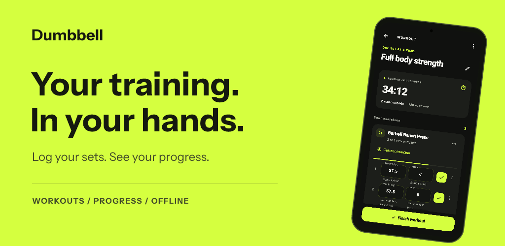
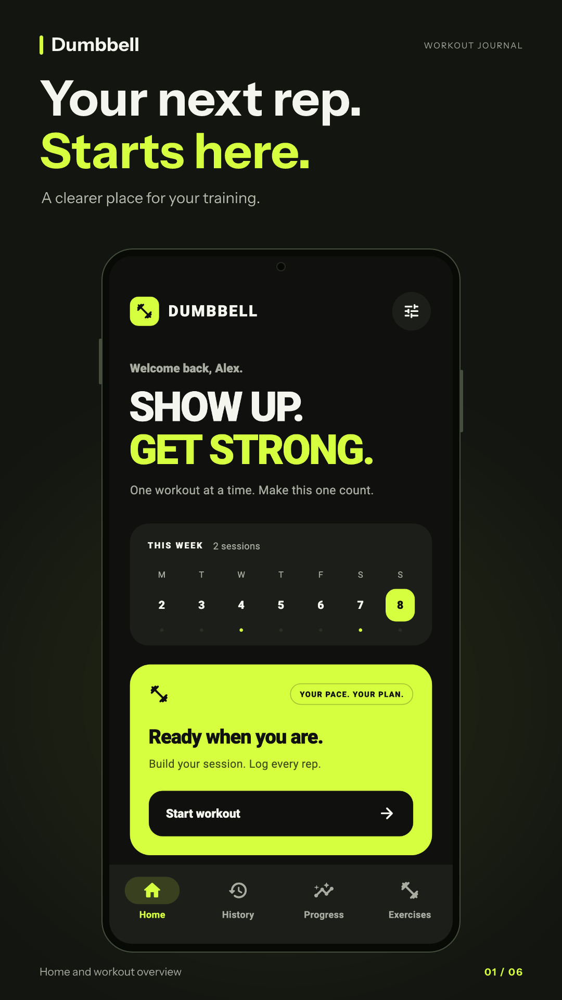
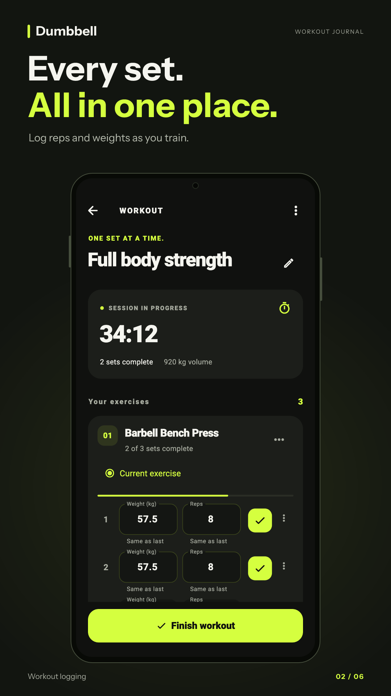
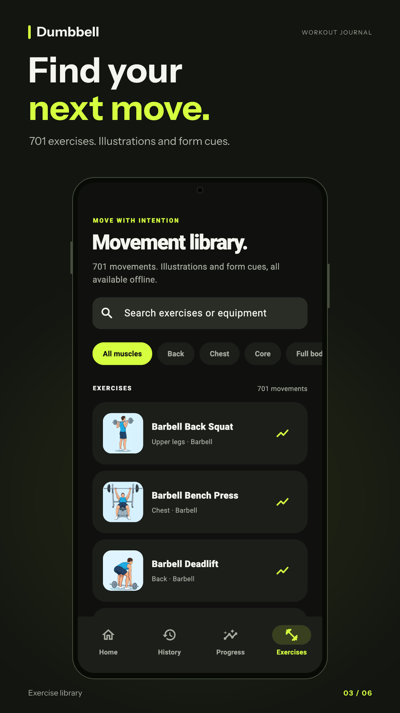
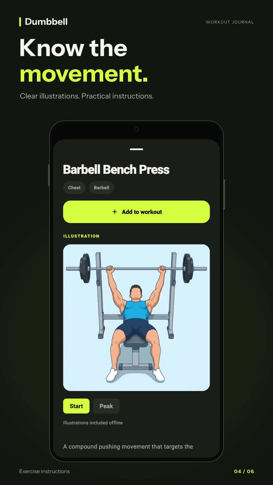
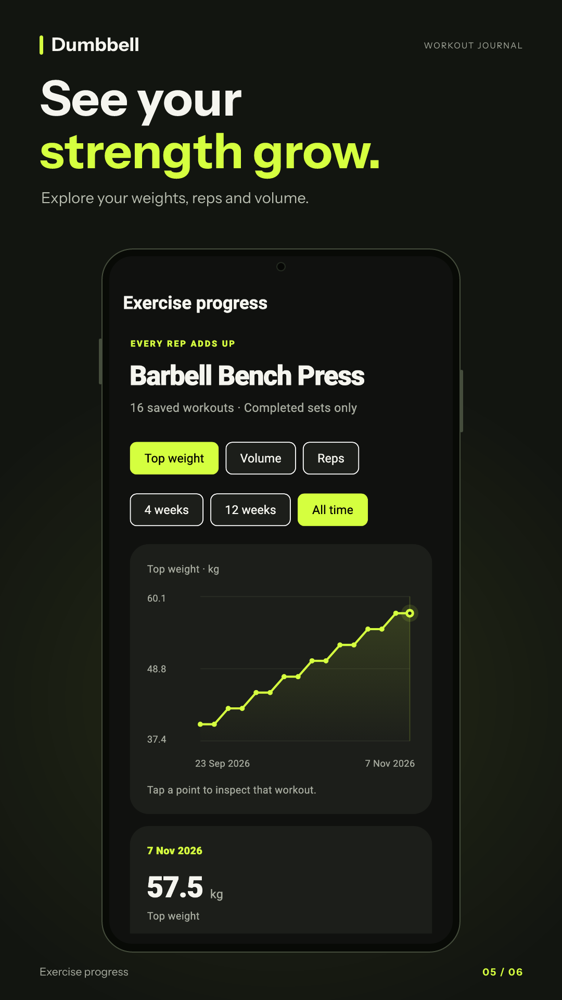
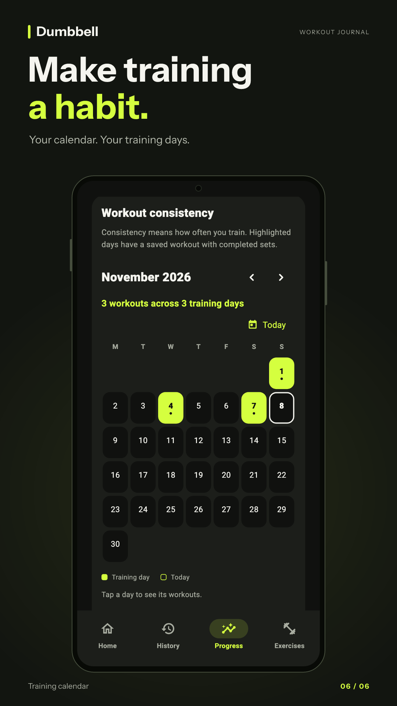

<p align="center">
  
</p>

<h1 align="center">Dumbbell</h1>

<p align="center">
  <strong>A free, offline workout journal. No account, ads, or subscription.</strong><br />
  Log your sets, explore exercises, and see your strength grow — with your training records stored on your device.
</p>

<p align="center">
  <a href="https://designingsystems.dev/app/dumbbell">Website</a> ·
  <a href="https://play.google.com/store/apps/details?id=com.savagecarol.dumbbell">Google Play — coming soon</a> ·
  <a href="https://designingsystems.dev/app/dumbbell/privacy">Privacy policy</a> ·
  <a href="#getting-started">Run locally</a>
</p>

> **Google Play:** The listing is not publicly available yet. The link above points to Dumbbell's store page for when it is published.

## Screenshots

<table>
  <tr>
    <td align="center" width="33%"><br /><strong>Your training, at a glance</strong></td>
    <td align="center" width="33%"><br /><strong>Log every set</strong></td>
    <td align="center" width="33%"><br /><strong>Find your next move</strong></td>
  </tr>
  <tr>
    <td align="center"><br /><strong>Know the movement</strong></td>
    <td align="center"><br /><strong>See your strength grow</strong></td>
    <td align="center"><br /><strong>Build a training habit</strong></td>
  </tr>
</table>

Screenshots show the actual app interface with example workout data.

## What you can do

| Feature | Details |
| --- | --- |
| **Log workouts** | Record exercises, sets, repetitions, and weights in kg or lb. Previous workouts prefill your next session's sets. |
| **Resume your session** | Keep an elapsed workout timer and an automatically saved draft. Resume, finish, or discard when you return. |
| **Explore 701 exercises** | Browse an offline library with search, muscle filters, instructions, and 1,217 illustrations. |
| **Track progress** | View top weight, volume, and repetition charts for each exercise, plus body-weight history. |
| **See your consistency** | Browse saved sessions in a monthly calendar and an eight-week training overview. |
| **Keep workouts in view** | Android home-screen widgets and workout notifications show elapsed time and the current exercise. |
| **Add photos and share** | Attach an optional workout photo and preview a Story or Square workout summary before opening the system share sheet. |
| **Export and restore** | Export a readable workout CSV, or use the separate Backup CSV format to back up and import supported training records. |

## Privacy and your data

Dumbbell works without an account. Training records, profile details, and attached photos stay in the app's private device storage. The app includes no advertising, analytics, tracking, or automatic crash-reporting services, and does not upload your records to a developer server.

Photo selection, notifications, exports, and sharing are optional. Sharing happens only when you request it and choose a destination through your device's share sheet.

Export a **Backup CSV** if you want a restorable copy of supported training records. Backup CSV excludes profile details and photos. Clearing app storage, uninstalling the app, or losing your device can remove local records; there is no server copy to restore.

Read the full [privacy policy](https://designingsystems.dev/app/dumbbell/privacy).

## Getting started

Install the Flutter SDK with Dart **3.13.7 or later**, then run:

```sh
git clone https://github.com/savagedevs/dumbell.git
cd dumbell/workout_app
flutter pub get
flutter run
```

Android and iOS are the main application targets. Android widgets and workout notifications are platform-specific; they require an Android device or emulator. For emulator helpers and platform setup, see the [app README](workout_app/README.md).

### Development checks

From `workout_app/`:

```sh
flutter analyze
flutter test
```

For Android integration checks on a running emulator:

```sh
./tool/test_android.sh emulator-5554
```

### Built with

- **Flutter and Dart** for the application interface and logic.
- **GetX** for navigation and reactive application state.
- **Sembast** for local record storage, with IndexedDB storage on the web target.
- **Native Android integrations** for home-screen widgets and workout notifications.

## Project structure

```text
workout_app/
  lib/app/          App startup, routes, controllers, and state
  lib/core/         Visual tokens, shared widgets, and formatting
  lib/data/         Models, exercise catalogue, and local persistence
  lib/features/     Home, workouts, exercises, history, progress, and settings
  assets/           Branding, exercise illustrations, and legal notices
  android/          Android app, widget, and notification integration
  test/             Domain, persistence, controller, and UI tests
  tool/             Import, artwork, screenshot, and release tools
docs/               Specifications, source credits, and release documentation
store-assets/       Store graphics and app screenshots
screenshot/         Original visual references
```

See [release instructions](docs/releasing.md) for Android signing and packaging, and [store preparation](docs/store/play-store-preparation.md) for publication details. Private signing keys, machine settings, dependencies, and build output are excluded from version control.

## Exercise data and credits

[Exercise data by RepDB (repdb.co)](https://repdb.co). The bundled exercise catalogue and illustrations are used inside the application under the [RepDB Free Tier License](workout_app/assets/exercises/licenses/REPDB-FREE-LICENSE.md). The artwork is identified by RepDB as AI-generated. These assets are not offered as a standalone dataset; their upstream license applies.

Read [exercise sources and licenses](docs/exercise-sources.md) for provenance, attribution, and import details.

## Links and support

- [Dumbbell website](https://designingsystems.dev/app/dumbbell)
- [Google Play listing — coming soon](https://play.google.com/store/apps/details?id=com.savagecarol.dumbbell)
- [Privacy policy](https://designingsystems.dev/app/dumbbell/privacy)
- [Report a bug or request a feature](https://github.com/savagedevs/dumbell/issues)
- [Email support](mailto:svgcarol@gmail.com)
